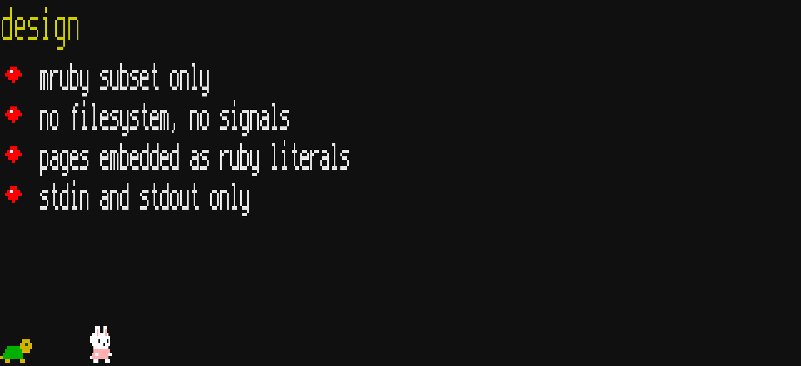
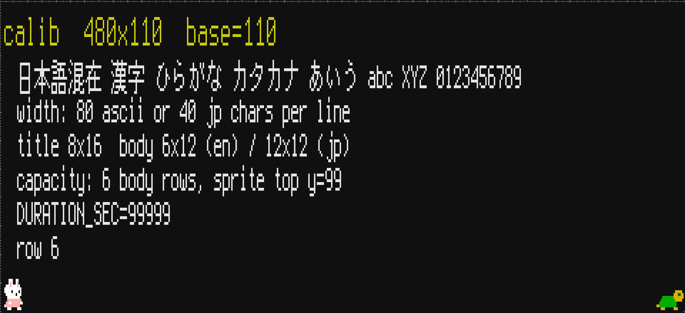
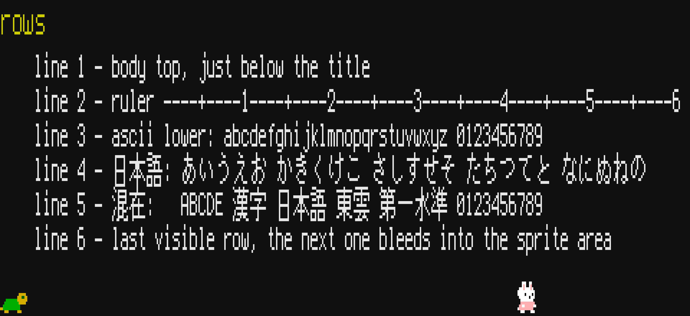

# facet

facet は、端末で見せるスライドツールで、[mruby](https://mruby.org/) で動きます。



facet は、スライドの文字を端末のフォントではなく、同梱のビットマップフォントで描きます。
そのため、端末のフォントが何であっても、スライドの字形は変わりません。

描くときは、字の点 1 つを端末の 1 文字に置き換えます。
点のある所には `█`（U+2588 FULL BLOCK）を書き、点のない所は空けておきます。
端末の 1 セルが 1 ピクセルにあたるので、スライド 1 枚は文字を並べて作った絵になります。
端末の文字を小さくすると、1 セルが小さな点に見え、スライドが 1 枚の画像のように見えます。

画面の下端には兎と亀のスプライトが並び、兎はページの進み具合を、亀は経過時間を示します。
スプライトも 1 セルを 1 ピクセルとして、背景色を付けた空白を並べて描いています。

facet が実行中に読むのは、標準入力から来るキー操作だけです。
スライドの中身は `slide.rb` に Ruby のリテラルで書き、ビルドのときにフォントと一緒に 1 つの `facet.mrb` へまとめます。

## 動かし方

mruby（`mrbc` と `mruby`）が必要です。
開発には mruby 4.0.0 を使っています。
端末は、256 色と UTF-8 を表示できるものを使います。

```sh
./build.sh
mruby -b facet.mrb
```

初期設定の画面は 480 × 110 セルあるので、端末の文字を小さくしてから起動します。
起動すると代替画面に切り替わり、終了すると元の画面に戻ります。
画面の大きさを端末に合わせる方法は、「画面の大きさを合わせる」の節に書いています。

## 操作

入力は 1 行ずつ読むので、どのキーも Enter で確定します。

- **l**、または Enter だけ：次のページ
- **h**：前のページ
- **q**：終了

## 画面の大きさを合わせる

`-c` を付けて起動すると、キャリブレーション画面が出ます。
この画面は、四隅に `+` を、上端と左端に目盛りを描き、フォントの大きさ、1 行に入る文字数、本文の行数も表示します。
端末の文字の大きさと、起動時に渡す画面の幅と高さを変えながら、四隅の `+` がすべて見える組み合わせを探します。



決めた幅と高さは、`slide.rb` の `SCREEN_COLS` と `SCREEN_ROWS` に書くと、次のビルドから使われます。
起動オプションはどれも、`slide.rb` の値をその回の起動だけ上書きするので、ビルドし直さずに試せます。

```sh
mruby -b facet.mrb [COLS ROWS] [-c] [-b N] [-d N]
```

- **COLS ROWS**：画面の幅と高さ（`SCREEN_COLS` と `SCREEN_ROWS`）を上書きします。どちらも 11 以上の値を受け付けます。
- **-c**、**--calibrate**：キャリブレーション画面を出します。
- **-b N**、**--baseline N**：兎と亀の足元の行（`SPRITE_BASELINE`）を上書きします。11 以上の値を受け付け、画面の高さを超えてもかまいません。
- **-d N**、**--duration N**：亀が右端に着くまでの秒数（`DURATION_SEC`）を上書きします。

## スライドの書き方

スライドは、`slide.rb` の `PAGES` に 1 ページを 1 つのハッシュとして並べて書きます。
書き換えたら、ビルドし直します。

```ruby
PAGES = [
  { title: "facet",
    body: ["- 箇条書きの行",
           "  ふつうの行",
           ""] },
]
```

本文の行のうち `-` で始まるものは箇条書きになり、`-` とそれに続く空白の代わりに赤い印が付きます。
空文字列は空行になります。

本文には英数字と日本語を混ぜて書けます。
日本語は、JIS X 0208 の 1 区の記号、ひらがな、カタカナ、第1水準漢字を描けます。
フォントに入っていない字は空白で描きます。



フォントは `slide.rb` の 3 つの定数で選びます。

- **TITLE_FONT**：タイトルの英数字のフォントです。`FONT_6x12`、`FONT_8x16`、`FONT_12x24`、`FONT_16x32` から選びます。タイトルの日本語は、この高さに合わせて東雲フォントの 12 ドットか 16 ドットを使い、24 と 32 のときは整数倍に拡大します。
- **BODY_EN_FONT**：本文の英数字のフォントです。選べるものは `TITLE_FONT` と同じです。
- **BODY_JP_FONT**：本文の日本語のフォントです。`SHINONOME_K12` か `SHINONOME_K16` を選びます。

## shim 版

facet には、`build.sh` で作る `facet.mrb`（以下、通常版）のほかに、`build-shim.sh` で作る `facet-shim.mrb`（以下、shim 版）があります。
shim 版は、通常版と同じソースに `shims.rb` を加えて作ります。
`shims.rb` は、facet が使う C 実装のメソッドのうち 13 個を Ruby で定義し直したもので、その分だけ facet が呼ぶ C のメソッドが減ります。
描く画面は通常版と同じです。

## テスト

```sh
./test/run.sh       # 通常版
./test/run-shim.sh  # shim 版
```

テストは mruby の `test/assert.rb` を使っているので、`mruby` だけで実行できます。
lint には CRuby の [RuboCop](https://rubocop.org/) を使い、`bundle install` の後に `bundle exec rubocop` で実行します。

## ライセンス

facet は MIT License です（[LICENSE](LICENSE)）。
同梱しているフォント、文字コードの対応表、スプライト、テスト用のコードのライセンスは、[LICENSE-3rdparty](LICENSE-3rdparty) に全文があります。

- [Terminus Font](https://terminus-font.sourceforge.net/) 4.49.1：SIL Open Font License 1.1
- [東雲フォント](http://openlab.ring.gr.jp/efont/shinonome/) 0.9.11：Public Domain
- 東雲フォントの UTF-8 から JIS への対応表（[Unicode](https://www.unicode.org/) の [JIS0208.TXT](https://www.unicode.org/Public/MAPPINGS/OBSOLETE/EASTASIA/JIS/JIS0208.TXT) から作ったもの）：Unicode License v3
- スプライト（[PicoRuby](https://github.com/picoruby/picoruby) の [picoruby-rapicco](https://github.com/picoruby/picoruby/tree/master/mrbgems/picoruby-rapicco) から取り込んだもの）：MIT License
- [mruby](https://github.com/mruby/mruby) の [`test/assert.rb`](https://github.com/mruby/mruby/blob/master/test/assert.rb)：MIT License
